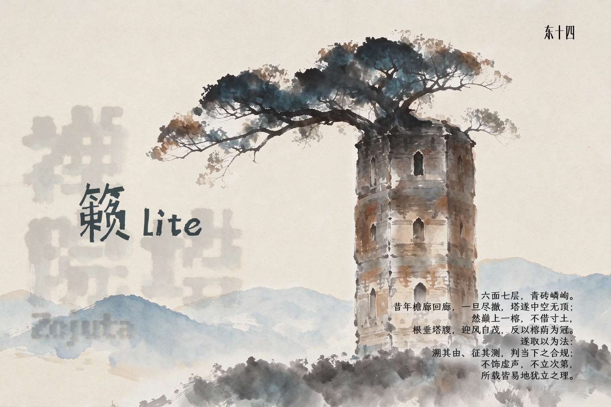
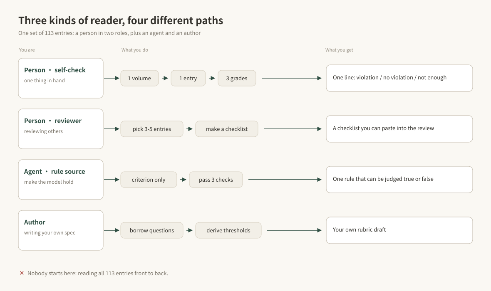

[中文](README.md) · English

# Zojuta Lite (禅院塔·籁) · a criteria set

**A set of criteria for auditing your own engineering. It doesn't hand you answers — it hands you the questions worth asking.**

> *Six sides, seven stories, weathered grey brick.*
> *Once its eaves and galleries were stripped away, the tower stood hollow and roofless —*
> *yet a banyan took root at its crown, borrowing not an inch of soil,*
> *dropping aerial roots down the hollow shaft to flourish in the wind, forming a canopy of its own.*
> *So it is taken as the method: trace its origin, demand its measurement, judge only what holds now;*
> *no borrowed rhetoric, no imposed hierarchy — everything kept must still stand elsewhere.*

This is the **criteria layer of the Zojuta main library** — a 2026-11-24 snapshot with a 2026-11-25 supplement, 17 volumes, 113 entries.

Zojuta is a general-purpose mother tower of engineering method. The name comes from the East Pagoda on Jiangxin Island in Wenzhou — a tower whose eaves and galleries were stripped away, leaving only the skeleton, with a banyan at its crown standing in for the roof. The criteria layer inherits exactly that skeleton: keep only "which questions are worth asking", keep no ceremony.

The main library is not open source. Only the criteria themselves are here: which questions are worth asking, and how far you have to answer them before a question counts as answered. The runtime layer (gate implementations, self-check scripts, catalog governance, release process) stays in the main library, not in this repo.

---

## What this is, and what it isn't

**Is**: 113 criteria, each able to answer one question — *does this run of mine count as a violation?*

**Isn't**: a checklist, a template, a best-practices collection.

Worth spelling out, because it decides how you use it.

A template gives you a note to play; you play it. A criterion gives you a question to ask; you answer it yourself. Wherever a threshold or a definition has to be set from the project's own situation, this collection gives you *how to set it*, never *what to set it to*. That isn't laziness leaving blanks — it's the position. The same criteria applied to different engineering should reach different conclusions.

So you'll see a lot of sentences like:

- "The floor must be derived back from actual execution results, not copied from a document" — not "set the floor at 50"
- "Red or not depends only on whether *headroom − increment* is negative; absolute size is irrelevant" — not "leave 5% headroom"
- "Judging 'absent' must be proven by the response content itself, not supported by the request parameters" — not "query three times"

The numbers live in the evidence section, not in the criterion section. Deliberately: a criterion has to hold across projects; a number only holds at the site where it was born.

## What Zojuta is

Zojuta is not an abstract tower. It is the **East Pagoda on Jiangxin Island, Wenzhou** — a physical thing you can point at. Every image in the name lands back on a criterion:

| The physical fact (checkable) | What it becomes in the criteria |
|---|---|
| Built in **869 CE** (Tang, Xiantong 10), earlier than the West Pagoda | The tower that judges **process** rises first: process criteria must stand while the work is happening, not be added after it is done |
| Its eaves and galleries were **torn down under foreign order**; it stands hollow and roofless | Criteria must still hold after outside parties strip the decoration: judge the skeleton (what was done, in what order), ⛔ never the ceremony |
| A **banyan crowns it**, giving shade where there is no roof | What is missing can be supplied by existing experience: when a criterion has a gap, fill it from general experience rather than inventing a rule |
| Six sides, seven stories, **each story separately inspectable** | Process can be checked segment by segment: one order, one check, never a whole impression |
| Served as a **navigation mark alongside the West Pagoda** for 800 years | Criteria must navigate for others: readability outranks completeness — if others can't read it, it isn't compliance |

The two pagodas judge two different things: **the East judges "was this step done right"** (present, segment by segment, re-checkable), **the West judges "has this person actually changed"** (delayed, scored, requiring an evidence ledger). Merge them into one and you get the old failure of settling a result claim with process compliance — a counter-example the main library writes down explicitly.

The Latin slot `Zojuta` shares a `-juta` tail with another tower in the same family, distinguished by the head `Zo-`. `Zo` takes the Suzhou reading of 禅, `zoe` (the Wenzhou reading `ji` would give `Jijuta`, an awkward `j-j` cluster); the last two segments stay Wenzhou: `ju` for 院 `jy`, `ta` for 塔 `tʰa`. It is the main library's single cross-dialect borrowing, and the reason is fixed in writing there.

## Why it's called 籁 (lài)

籁 comes from the *Zhuangzi*, "Discussion on Making All Things Equal" (齐物论). Ziqi has finished describing the sounds of earth and the sounds of men; Ziyou asks about the sounds of Heaven. The answer:

> 夫吹万不同，而使其自己也，咸其自取，怒者其谁邪！

The wind blows, and the ten thousand hollows each sound differently — yet nothing outside them is setting their pitch. Each hollow sounds according to its own shape; the sound is its own taking. That is the sound of Heaven. *(Rendering ours; the Chinese is the source.)*

Naming a criteria set after it takes exactly that sense: **a criterion does not set the standard for your project; it makes you ask the questions your project's own shape calls for.**

`Lite` names the subtraction — criteria layer only — not a claim that it's thin. `Zojuta` is kept as-is with a suffix added: the main library's Latin name shares a `-juta` tail with a sibling library, and breaking the tail would unpair them.

**Where the two images connect.** The East Pagoda is hollow — its eaves and galleries are gone, and openings run through the shaft on every side. Wind passes through them and the tower sounds. That is exactly the shape of **地籁, the sounds of earth**, in the *Zhuangzi*: the wind blows and the ten thousand hollows each sound in their own way. So the tower is not a metaphor bolted onto 籁; the tower *is* the hollow body the wind plays through.

The distinction still has to be stated, or it becomes a weld: **地籁 is sound; 天籁 is the principle that nothing outside is setting the pitch.** The tower's hollow shaft and openings are the *shape* of 地籁 — each hollow sounding by its own shape. The criteria set's position is the *principle* of 天籁 — it does not set the standard for your project. They are two layers of the same passage in the *Zhuangzi*, not two unrelated image systems.

⛔ But do not put it as "籁 = the sound the tower makes": that flattens the principle into a sound, two layers into one. The tower sounding is 地籁; a criterion refusing to set your pitch is 天籁.

## How to read one criterion

Four parts, and an entry missing any of them doesn't get in:

| Part | Answers |
|---|---|
| **Problem** | Under what conditions does it go wrong |
| **Mechanism** | Why it goes wrong, by what path |
| **Evidence** | Who measured it under what conditions, and what the readings were |
| **Criterion** | Whether this run of yours counts as a violation, and how to tell |

A complete example (first entry in [`02a-断言记账`](criteria/02a-断言记账.md)):

> **Problem**: when the execution count and the acceptance transcript come from the same derivation source, deleting an assertion and tampering with the transcript in step can still leave the check showing a pass.
>
> **Mechanism**: set two independent floor observations — an execution-count floor and a static AST call-site floor, the latter covering defensive branches that normally never execute. Both floors may only be raised, never lowered.
>
> **Evidence**: in another mutation, one assertion was deleted and the transcript edited at the same time; the execution count came in one below the floor and the call-site count one below, so it was still judged a failure.
>
> **Criterion**: if deleting an assertion and editing the transcript in step still passes the check, this run is a violation. The comparison must be against an independently set floor, not against a number the subject reports about itself.

Note the last clause — *not against a number the subject reports about itself*. That's why it can answer "does this count as a violation": it gives you an operational comparison, not an adjective.

**How to use it**: don't read front to back. Go looking with the thing you're doing right now — you just wrote a gate, go to `02b`; you're reconciling, go to `01b`; you're signing off a delivery, go to `06`. Find the entry, read its criterion, ask yourself whether this run counts.

### Three ways to use it: know which reader you are

One set of criteria, three very different sets of moves. ⛔ Don't borrow someone else's method.

| You are | What you do | Where you enter | What you get |
|---|---|---|---|
| **A person**, doing the work, wanting to check yourself | Take the one thing in front of you into a volume and ask, entry by entry, "does this run count as a violation?" | §Contents → the volume → the criterion | A verdict in three grades: violation / no violation / insufficient evidence |
| **A person**, reviewing someone else's work | Pick 3–5 entries via the reverse lookup below, make them a short checklist, and write a line per item while reviewing | "Find the volume by situation" below | A checklist you can paste into the review record |
| **An agent**, wanting the model to hold the line itself | Rewrite **the criterion paragraph** as "must / must not" and put it in a system prompt or a gate description | the volume → criterion → rewrite | One condition that can be judged true or false |
| **An author**, writing your own standard | Borrow the question, not the numbers; derive thresholds on your own ground | any similar volume | Your own rubric draft |

⛔ What none of the three should do: read all 113 entries front to back. You won't retain them; you'll keep a few images instead.

#### Usage 1 · Self-check: one person, one thing, one hour

Pick something you're finishing, enter a volume from the situation table, read only 1–3 entries. Answer each in three grades: **violation / no violation / insufficient evidence**. "Can't tell" is insufficient evidence — the criterion is telling you to go get a reading, not to force a verdict.

> **Self-check sample** (first entry of `02a-断言记账`)
>
> - If I delete one assertion and edit the transcript in step, does the check still pass? If yes → violation.
> - The number I use to judge "passed" — is it reported by the subject itself, or an independently set floor? Self-reported → violation.

#### Usage 2 · As a rule source for an agent

Rewrite **only the criterion paragraph**. The problem and evidence paragraphs are context for humans; pouring the whole volume into a prompt just dilutes the instruction.

> **Rule sample sentence** (same entry)
>
> The pass condition of the check must not be taken from counts the subject reports about itself. Execution count and static call-site count must be two independent floors, and may only be raised, never lowered; lowering either makes this change non-compliant.

Three conditions for a rewrite — miss one, don't put it in a prompt: ① the subject is "must / must not", not "should consider"; ② it carries a comparison that can be judged true or false (a number, a state, whether something exists); ③ it carries no project names or concrete numbers from this collection.

#### Usage 3 · Writing your own rubric

Borrow the question, not the numbers. Turn the problem paragraph into your check item and the criterion paragraph into your pass condition; leave the threshold value to your own ground — the first entry of `01a-阈值与对照` says exactly why it can't be copied from a document.

### The fifteen-minute path

1. Open the contents table, pick **one** volume from the situation table below. One.
2. Pick **one** entry in that volume and read all four paragraphs — about three minutes.
3. Answer once against the thing in your hands: violation / no violation / insufficient evidence.
4. Write the verdict as one line: "volume·entry · verdict · the reading or file it rests on".
5. Do it again with another entry. After three, you'll know which volume you should live in.

After those five steps you're not holding "a collection to read" — you're holding a checklist.

### Find the volume by situation

| What I'm doing | Go to | Ask this first |
|---|---|---|
| Setting a threshold, running a control | [`01a`](criteria/01a-阈值与对照.md) (9) | Is this floor back-derived from actual results, or copied from a document? |
| Counting runs, measuring coverage, calibrating an instrument | [`01b`](criteria/01b-口径与计数.md) (9) | Is the counting convention defined first? Has the instrument been re-checked? |
| Writing assertions, editing tests | [`02a`](criteria/02a-断言记账.md) (5) | Does it still pass with one assertion deleted? Is every non-PASS entry booked? |
| Writing a gate, adding a check | [`02b`](criteria/02b-闸门设计.md) (9) | Has this gate ever gone red? Does red mean the world actually changed? |
| Writing to disk, migrating, anything with side effects | [`05`](criteria/05-副作用与写入安全.md) (7) | What is the evidence before, during and after the write? |
| Reconciling, accepting, delivering | [`06`](criteria/06-交付与验收.md) (8) | Which layer of done are you at? Does a preview passing mean delivery passed? |
| Parallel sessions, handover, review | [`07`](criteria/07-协作与评审.md) (12) | Did you hand over the verdict or the evidence? Did the retelling drift? |
| Chasing a nondeterministic bug, probing | [`08`](criteria/08-探测与瓶颈.md) (8) | Have you fixed the shape first, or are you burning calls? |
| Moving data, archiving, changing machines | [`09`](criteria/09-迁移与归档.md) (3) | Is it a byte-for-byte move? Did the full hashes reconcile? |

## Contents (17 volumes / 113 entries)

> This table is organised by volume, for orientation. If you have one specific thing in hand and don't know which volume, use "Find the volume by situation" above.

| Volume | Entries | Covers |
|---|---|---|
| [`00-定名`](criteria/00-定名.md) | — | Where the name comes from (not criteria; sits at the front) |
| [`01a-阈值与对照`](criteria/01a-阈值与对照.md) | 9 | Thresholds need a physical basis; comparisons must be same-source, same-environment |
| [`01b-口径与计数`](criteria/01b-口径与计数.md) | 9 | Define the counting convention first; the measuring instrument needs checking too |
| [`02a-断言记账`](criteria/02a-断言记账.md) | 5 | Assertion-count floors, booking non-PASS results, criteria must be executable |
| [`02b-闸门设计`](criteria/02b-闸门设计.md) | 9 | A gate must be able to go red, and red must mean the world changed |
| [`03a-锚点与引用`](criteria/03a-锚点与引用.md) | 7 | Anchor validity needs a convention; an excerpt is evidence |
| [`03b-解析与切块`](criteria/03b-解析与切块.md) | 7 | Stable identity for parsed lines, structural skeleton, dedup |
| [`04a-状态真相`](criteria/04a-状态真相.md) | 6 | On disk, or an API returning 200, still isn't "in use" |
| [`04b-就绪与收敛`](criteria/04b-就绪与收敛.md) | 9 | Self-check saying ready isn't "in use"; baselines refresh only on write |
| [`05-副作用与写入安全`](criteria/05-副作用与写入安全.md) | 7 | What evidence you need before, during, and after a write |
| [`06-交付与验收`](criteria/06-交付与验收.md) | 8 | Completion has four layers; a preview passing isn't a delivery passing |
| [`07-协作与评审`](criteria/07-协作与评审.md) | 12 | Parallel seats, handoff, relay, triaging external models |
| [`08-探测与瓶颈`](criteria/08-探测与瓶颈.md) | 8 | The economics of probing: fix the shape before you talk about calls |
| [`09-迁移与归档`](criteria/09-迁移与归档.md) | 3 | Whole-tree byte-exact moves, full hash reconciliation, compute goes to the data |
| [`10-排版与渲染`](criteria/10-排版与渲染.md) | 6 | Metrics, increments, three-way comparison, end-to-end build |
| [`11-依赖与就绪`](criteria/11-依赖与就绪.md) | 5 | A name isn't an existence; conjunctive conditions need each end proven |
| [`12-文档治理`](criteria/12-文档治理.md) | 3 | Assign ownership first, derived views, goals that can't be expressed |

## Where these came from

Not thought up. Stepped in.

Every "Evidence" section is a real failure: a gate green while the thing was broken, a reconciliation that matched because both sides copied the same source, a self-check reporting ready when nothing had run, a delivery reported complete that the user couldn't open. These criteria are the scars those incidents left.

So they share one feature: **they all point at "looks right but isn't."** That's the real subject of this collection. If you remember one line, remember this one — green doesn't mean correct.

## Snapshot notice

**This repo takes the 2026-11-24 snapshot as its baseline, with one disciplined supplement on 2026-11-25: 113 entries. It still does not track the main library automatically.**

The main library is still growing (374 entries at present), and the redaction screening was done entry by entry, not as an automated pipeline. So what you have here is "what this criteria set looks like," not "the latest version."

- Criteria are method, not software. Method doesn't need to follow version numbers.
- Whether to add more later is a separate discussion. This repo makes no update-cadence commitment.
- Every entry has been redacted: project names, paths, internal ids, dates, and precisely reverse-lookupable readings have been stripped or turned into relative quantities. The numbers kept are the ones the criterion needs in order to stand.

If you find an entry whose evidence section was redacted into something that no longer holds up — all abstraction, no support for the conclusion — that's our mistake. Open an issue.

## License and attribution

**Creative Commons Attribution 4.0 International (CC BY 4.0)** — full text in [LICENSE](LICENSE),
attribution and copyright in [NOTICE](NOTICE).

This collection is criteria text, not software, so it uses neither Apache 2.0 nor MIT: what it wants
is for the content to be freely quoted, excerpted, put into curricula and review checklists. CC BY 4.0
is the general licence at exactly that scale — commercial use included, and no obligation to paste
our full licence into your product.

The trade-off, stated plainly: CC BY 4.0 **grants no patent or trademark rights (§2(b)(2))**. There is
no code and no implementation here, so a patent clause would have nothing to license; the names
禅院塔·籁 and Zojuta Lite are likewise not licensed along with the text.

**Attribution requirement** (§3(a)(1)): when you use, excerpt or redistribute, keep
`Copyright (c) 2026 L4ST-afk`, name the licence (CC BY 4.0) and link to it; if you changed the content
and redistribute it, state at the change what you changed (§3(a)(1)(B)). Quoting a handful of entries
still counts as use and still needs attribution — but not the full licence text.

---

**Zojuta Lite (禅院塔·籁)** · criteria-layer snapshot 2026-11-24 · supplemented 2026-11-25 · 113 entries / 17 volumes
